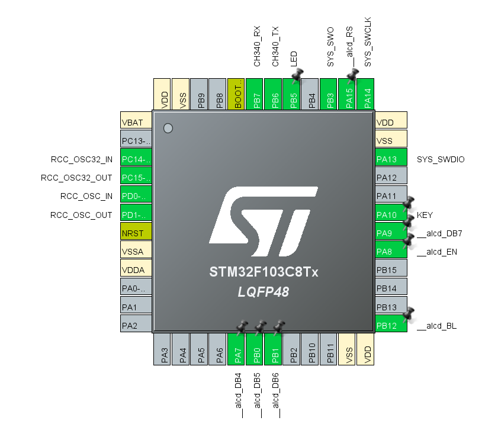
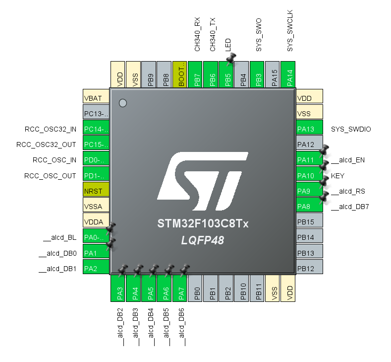

# aLCD Library - API Reference

This library provides a complete driver for HD44780-compatible 16x2 alphanumeric LCD displays. It supports both 4-bit and 8-bit communication modes, offering flexibility for different hardware configurations and project requirements.

## Communication Modes

The library is available in two versions located in separate folders:

```
STM32_HAL_aLCD_GPIO
└── source/
    ├── 4-bit mode/
    │   ├── alcd.h
    │   └── alcd.c
    └── 8-bit mode/
        ├── alcd.h
        └── alcd.c
```

### 4-Bit Mode

**Description:**  
Data is transmitted through 4 pins (DB4-DB7). Each byte is sent in two stages (upper and lower nibble).

**Advantages:**
- Fewer pins required (6 pins total: RS, EN, DB4-DB7)
- Ideal for microcontrollers with limited GPIO
- Simplified wiring and reduced hardware complexity
- Backlight control available (optional 7th pin)

**Disadvantages:**
- Slower communication speed (two cycles per byte)

**Pin Requirements:**
- 2 Control pins: RS, EN
- 4 Data pins: DB4, DB5, DB6, DB7
- 1 Optional pin: Backlight (BL)

**Use Cases:**
- Projects with limited GPIO availability
- Simple applications where speed is not critical
- Battery-powered devices (fewer active pins)

---

### 8-Bit Mode

**Description:**  
All 8 data bits (DB0-DB7) are transmitted in parallel simultaneously.

**Advantages:**
- Faster communication speed (complete byte sent in one cycle)
- Simpler implementation and timing
- More reliable data transmission

**Disadvantages:**
- More pins required (10 pins total: RS, EN, DB0-DB7)
- More complex wiring

**Pin Requirements:**
- 2 Control pins: RS, EN
- 8 Data pins: DB0, DB1, DB2, DB3, DB4, DB5, DB6, DB7
- 1 Optional pin: Backlight (BL)

**Use Cases:**
- Performance-critical applications
- Projects with abundant GPIO resources
- Industrial applications requiring high reliability
- Systems with frequent LCD updates

---

## Hardware Pin Configuration

You can reassign LCD pins to any desired microcontroller GPIO pins by modifying the **User Labels** in STM32CubeMX.

**You MUST configure all LCD pins in STM32CubeMX before using this library.** The GPIO definitions are automatically generated by CubeMX when you assign User Labels to the pins.

### CubeMX Configuration Steps:
1. Open Pinout & Configuration tab
2. Select desired GPIO pins
3. Set GPIO mode to `GPIO_Output`
4. Set GPIO output level to `Push Pull`
5. Set GPIO speed to `Low` or `Medium`
6. Enter the exact User Labels as shown above (e.g., __alcd_RS, __alcd_EN, etc.)
7. Generate code to create the GPIO definitions

### 4-Bit Mode Configuration:
Set these User Labels in CubeMX:
- **Control Pins:**
  - RS pin → `__alcd_RS`
  - EN pin → `__alcd_EN`
- **Data Pins:**
  - DB4 pin → `__alcd_DB4`
  - DB5 pin → `__alcd_DB5`
  - DB6 pin → `__alcd_DB6`
  - DB7 pin → `__alcd_DB7`
  


#### Default Pin Assignments - 4-Bit Mode

```c
/* Control Pins */
RS  -> PA15
EN  -> PA8

/* Data Pins */
DB4 -> PA7
DB5 -> PB0
DB6 -> PB1
DB7 -> PA9
```

### Backlight Configuration (Optional)

The backlight feature is optional for both modes. To enable it:

- **Optional Backlight:**
  - BL pin → `__alcd_BL`
  
#### Default Pin Assignments - 8-Bit Mode
```c
/* Optional Backlight */
BL  -> PB12
```

### 8-Bit Mode Configuration:
Set these User Labels in CubeMX:
- **Control Pins:**
  - RS pin → `__alcd_RS`
  - EN pin → `__alcd_EN`
- **Data Pins:**
  - DB0 pin → `__alcd_DB0`
  - DB1 pin → `__alcd_DB1`
  - DB2 pin → `__alcd_DB2`
  - DB3 pin → `__alcd_DB3`
  - DB4 pin → `__alcd_DB4`
  - DB5 pin → `__alcd_DB5`
  - DB6 pin → `__alcd_DB6`
  - DB7 pin → `__alcd_DB7`
  


#### Default Pin Assignments - 4-Bit Mode

```c
/* Control Pins */
RS  -> PA9
EN  -> PA11

/* Data Pins */
DB0 -> PA1
DB1 -> PA2
DB2 -> PA3
DB3 -> PA4
DB4 -> PA5
DB5 -> PA6
DB6 -> PA7
DB7 -> PA8
```


> [!IMPORTANT]
> The backlight pin (typically LCD pin 16, LED-) should be driven through an NPN transistor to handle the current properly and protect the microcontroller.

---

# 🌟 Support Me
If you found this repository useful:
- Subscribe to my [YouTube Channel](https://www.youtube.com/@aKaReZa75).
- Share this repository with others.
- Give this repository and my other repositories a star.
- Follow my [GitHub account](https://github.com/aKaReZa75).

# ✉️ Contact Me
Feel free to reach out to me through any of the following platforms:
- 📧 [Email: aKaReZa75@gmail.com](mailto:aKaReZa75@gmail.com)
- 🎥 [YouTube: @aKaReZa75](https://www.youtube.com/@aKaReZa75)
- 💼 [LinkedIn: @akareza75](https://www.linkedin.com/in/akareza75)
